# wifi.et mini app (clickable demo)

A clickable HTML demo of selling **wifi.et** Wi-Fi packages through the **telebirr** wallet, prepared by ethio telecom Enterprise Business Development.

> Demo only. No real payments, codes or customer data. Names, prices, hotspots and review times are placeholders.

## Run it

Open `index.html` in any browser. It is one self-contained file with no build step and no server.

## What it shows

Two channel options for selling the same Wi-Fi packages:

| Option | Where it lives | Flow |
|---|---|---|
| **A · Inside Airtime / Package** | A new Wi-Fi tab next to Internet and Voice in telebirr | Home → Airtime/Package → pick plan → confirm → PIN → Wi-Fi code |
| **B · wifi.et mini app** | telebirr Apps list | Apps → wifi.et → pick plan → pay → code → My Wi-Fi |

Switch between them inside the phone: **Apps** on the telebirr home opens Option B; **Home** on the Apps screen returns to Option A.

The mini app (Option B) also covers:

- **Hotspots**: map and list of nearby hotspots, QR scan to connect
- **My Wi-Fi**: live pass with data left, purchase history
- **Profile and Inbox**: weekly data use, receipts, offers and alerts
- **wifi.et for Business**: advertising formats, legal KYC (business details and documents), then a request to the sales team

## Screens

| Option A | | | |
|---|---|---|---|
| 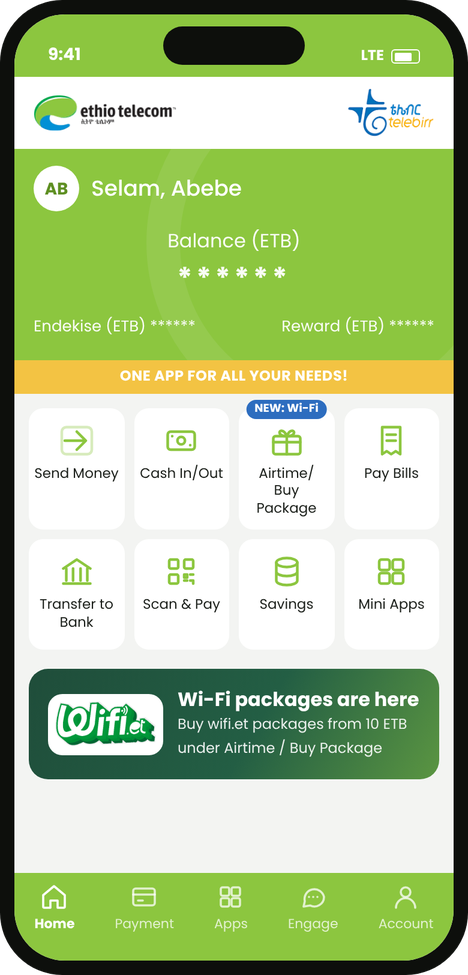 | 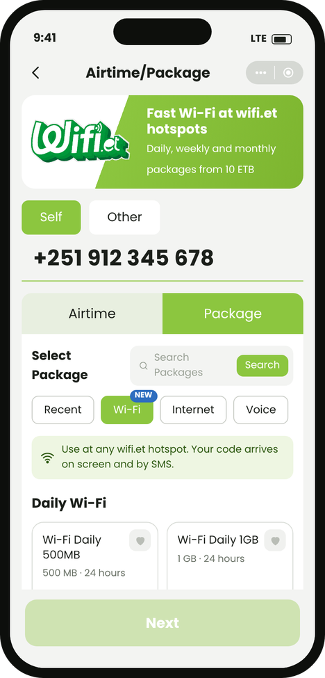 | 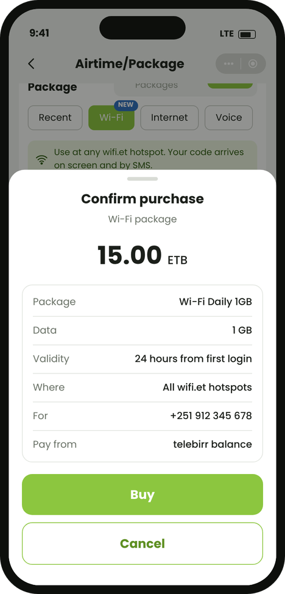 | 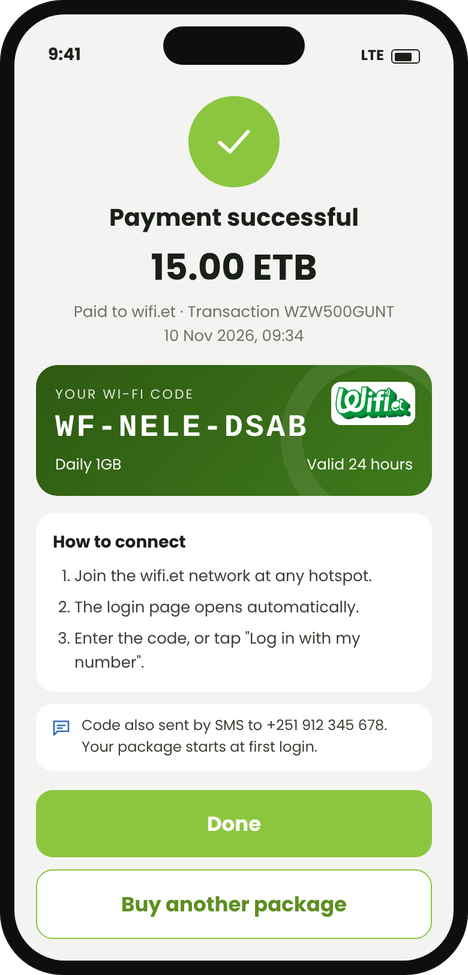 |

| Option B | | | |
|---|---|---|---|
| 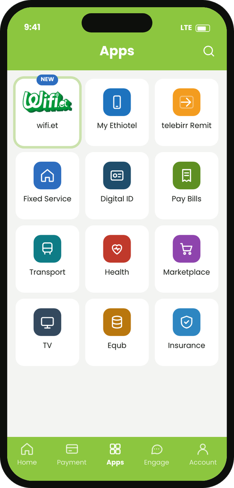 | 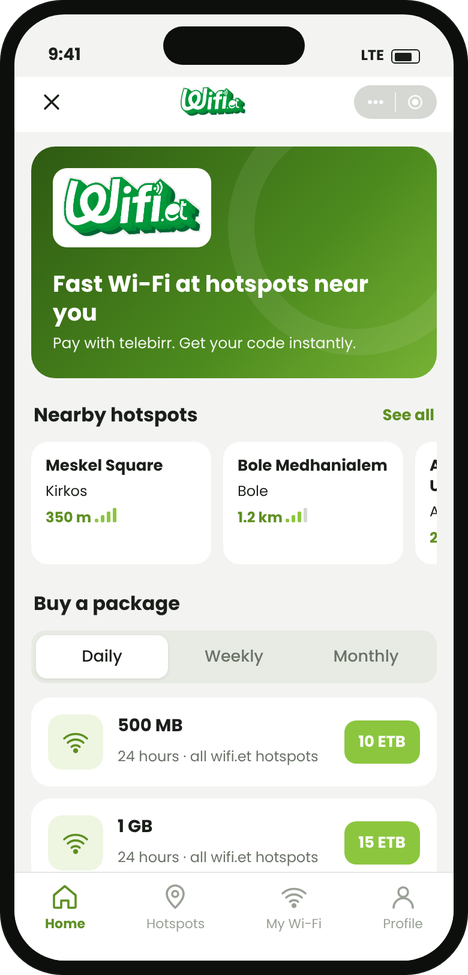 | 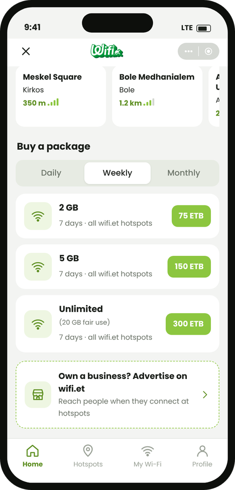 | 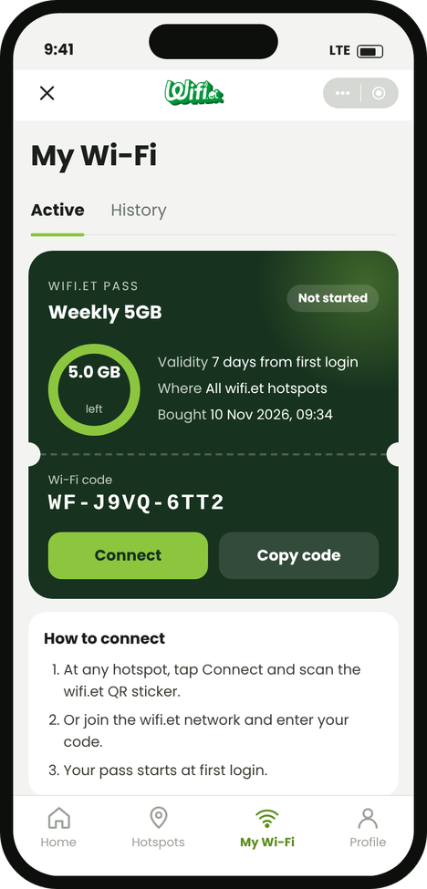 |

| Hotspots and business | | | |
|---|---|---|---|
| 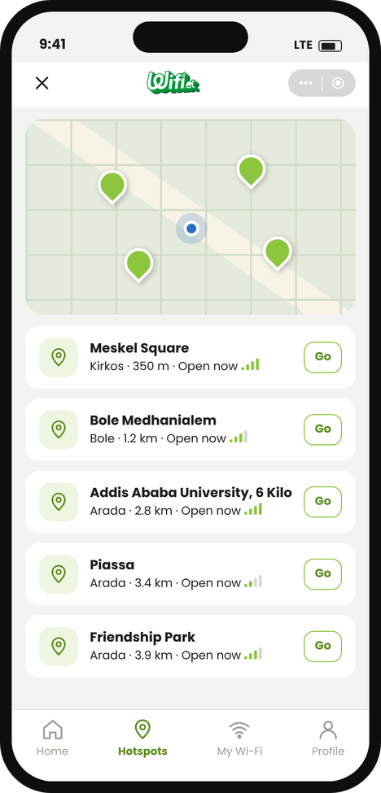 | 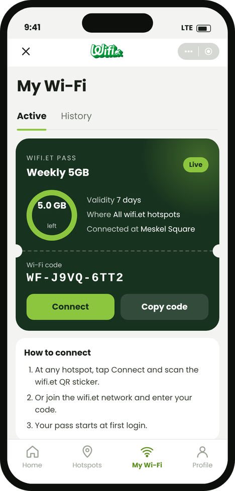 | 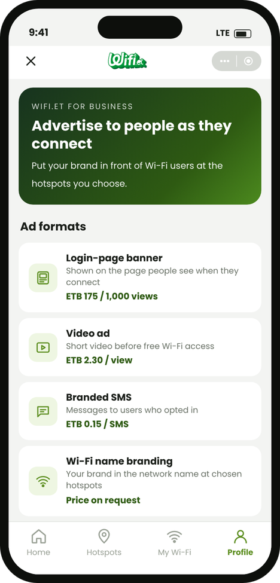 | 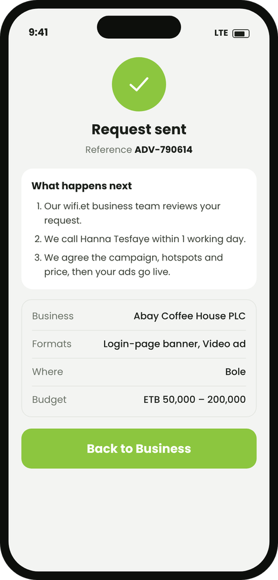 |
